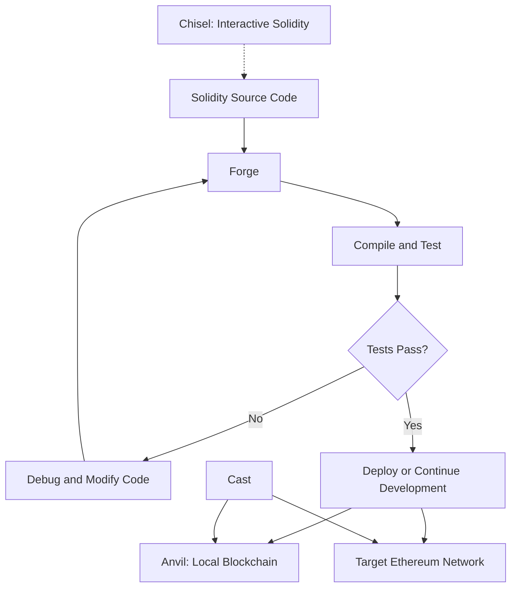
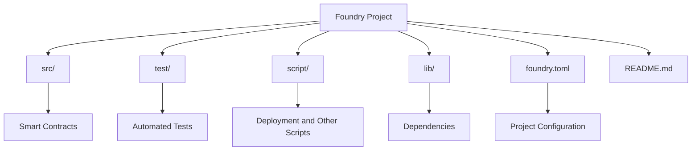

# Day 01: Introduction to Foundry

## Overview

This day introduces Foundry, its core tools, installation process, project initialization, and standard project structure.

The focus is on understanding the development environment and the purpose of each tool before moving on to writing and testing smart contracts.

## Learning Objectives

By the end of this session, I covered:

- Understanding what Foundry is and why it is used for Ethereum development.
- Installing Foundry and verifying the toolchain.
- Initializing a new Foundry project.
- Understanding the default structure of a Foundry project.

## Topics Covered

1. Introduction to Foundry
2. Foundry Installation
3. Project Initialization
4. Project Structure

---

## 1. What Is Foundry?

Foundry is a fast, portable, and modular toolkit for Ethereum application development. It provides command-line tools for compiling, testing, debugging, deploying, and interacting with smart contracts.

Unlike development environments that rely primarily on graphical interfaces, Foundry offers a command-line workflow that integrates naturally with Solidity, automated testing, and version control.

### Why Foundry?

- **Solidity-native workflow:** Write smart contracts and tests in Solidity.
- **Automated testing:** Test contract behavior and validate expected outcomes.
- **Fast development cycle:** Compile and test contracts directly from the terminal.
- **Local blockchain development:** Run a local Ethereum node for experimentation.
- **Command-line interaction:** Execute transactions and inspect blockchain data.
- **Reproducible projects:** Keep source code, tests, and configuration under version control.

## 2. The Foundry Toolchain

Foundry consists of several tools, each designed for a different part of the development workflow.

| Tool | Primary Purpose |
|---|---|
| **Forge** | Build, test, debug, and deploy smart contracts. |
| **Cast** | Interact with Ethereum networks, contracts, and blockchain data from the command line. |
| **Anvil** | Run a local Ethereum development node. |
| **Chisel** | Experiment with Solidity in an interactive command-line environment. |

### How the Tools Work Together

The following diagram illustrates their main roles in a typical smart contract development workflow.



*Note: This is a conceptual workflow. The tools can be used independently, and deployment targets depend on the development environment and configuration.*

### 2.1 Forge

Forge is Foundry's primary build and testing tool.

It can be used to:

- Compile Solidity contracts.
- Run automated tests.
- Debug test failures.
- Measure gas usage during testing.
- Deploy contracts using configured deployment commands.

Common commands:

```bash
forge build
forge test
forge test -vvvv
```

`forge build` compiles the project, `forge test` runs its tests, and `forge test -vvvv` provides detailed execution traces useful for debugging.

### 2.2 Cast

Cast provides command-line utilities for interacting with Ethereum.

It can be used to:

- Query blockchain information.
- Read contract state.
- Send transactions.
- Encode and decode contract-related data.
- Work with addresses, hashes, and other Ethereum values.

For example:

```bash
cast --help
```

This displays the available Cast commands and their usage.

### 2.3 Anvil

Anvil runs a local Ethereum node for development and testing.

It allows developers to:

- Experiment without deploying every change to a public network.
- Send transactions to a local blockchain.
- Test interactions between contracts.
- Work with local accounts and development funds.

To start a local node:

```bash
anvil
```

Anvil displays local account information and network details in the terminal. Keep the process running while using that node, and use a separate terminal for other commands.

### 2.4 Chisel

Chisel is an interactive Solidity REPL (Read-Eval-Print Loop).

It is useful for experimenting with Solidity expressions and inspecting their results without creating a complete project for every small experiment.

To explore its available commands:

```bash
chisel --help
```

## 3. Understanding the Development Workflow

A typical Foundry development cycle follows these stages:

1. Write or modify Solidity source code.
2. Compile the contracts using Forge.
3. Write and execute tests.
4. Investigate failures and debug the implementation.
5. Run local experiments using Anvil when needed.
6. Deploy contracts to the intended environment.
7. Interact with deployed contracts using Cast.
8. Review the results and update the code.

The exact workflow depends on the project. Not every task requires all four tools.

---

## Key Takeaways

- Foundry is a toolkit rather than a single command.
- Forge handles the core build and testing workflow.
- Cast provides command-line interaction with Ethereum.
- Anvil provides a local blockchain for development.
- Chisel provides an interactive environment for Solidity experiments.
- Understanding each tool's responsibility makes it easier to choose the right command for a given task.

---

## 4. Foundry Installation

Foundry can be installed using its official installation process. The installation provides the `foundryup` tool, which manages Foundry's toolchain.

On supported Unix-like environments, the installer can be invoked with:

```bash
curl -L https://foundry.paradigm.xyz | bash
```

Then install or update the Foundry tools:

```bash
foundryup
```

After installation, verify that the commands are available:

```bash
forge --version
cast --version
anvil --version
chisel --help
```

### Installation Notes

- `foundryup` installs or updates the Foundry toolchain.
- The Foundry binaries must be available through the system's `PATH`.
- If a command is not recognized, check the installation location and `PATH` configuration before reinstalling.
- Installation commands can differ by operating system and shell. Follow the official Foundry documentation for the environment being used.

Official documentation: https://getfoundry.sh/

## 5. Initializing a Foundry Project

`forge init` creates a new Foundry project structure in the target directory.

### 5.1 Initialize a Project in a New Directory

Create a directory and enter it:

```bash
mkdir my-foundry-project
cd my-foundry-project
```

Initialize the project:

```bash
forge init
```

Forge generates the default project structure, including Solidity source files, tests, scripts, configuration, and supporting files.

### 5.2 Initialize an Existing Empty Directory

If the directory already exists and is empty, navigate into it and run:

```bash
forge init
```

The current directory becomes the project location. You do not need to create another nested project directory.

### 5.3 Initialize a Non-Empty Directory

By default, Forge expects the target directory to be empty or suitable for initialization. If it contains existing files, initialization may be refused.

The `--force` option allows initialization in a non-empty directory:

```bash
forge init --force
```

**Important:** Use `--force` only when you understand the existing directory's contents. It can overwrite or conflict with files generated by the project initializer. Check your files and preserve any important work before running it.

### Initialization Summary

| Command | Purpose |
|---|---|
| `forge init` | Initialize a Foundry project in the current directory. |
| `forge init --force` | Initialize a project even when the directory is non-empty. |

The key distinction is that `--force` relaxes the non-empty-directory restriction. It does not mean that the command is generally safer or preferable.

## 6. Default Foundry Project Structure

A standard project initialized by Forge commonly resembles the following structure:

```text
my-foundry-project/
├── src/
│   └── Counter.sol
├── test/
│   └── Counter.t.sol
├── script/
│   └── Counter.s.sol
├── lib/
├── foundry.toml
├── .gitignore
└── README.md
```

The exact files and directory contents may vary by Foundry version and initialization options.

### 6.1 `src/`

Contains Solidity source code, including the smart contracts being developed.

Example:

```text
src/
└── Counter.sol
```

### 6.2 `test/`

Contains automated tests for the contracts.

Foundry tests are commonly written in Solidity and executed using Forge.

Example:

```text
test/
└── Counter.t.sol
```

### 6.3 `script/`

Contains Solidity scripts used for tasks such as deployment and other scripted operations.

Example:

```text
script/
└── Counter.s.sol
```

### 6.4 `lib/`

Contains project dependencies, commonly including libraries installed through Foundry's dependency-management workflow.

### 6.5 `foundry.toml`

The main project configuration file. It controls settings such as source, test, script, and library directories, along with compiler and testing configuration.

### 6.6 `.gitignore`

Defines files and directories that Git should normally exclude from version control, such as generated build artifacts.

### 6.7 `README.md`

Documents the project, its purpose, setup instructions, and usage.

## 7. Visualizing the Project Structure



This diagram shows the relationship between the main project directories and their responsibilities.

## Key Takeaways

- Foundry installation provides the command-line tools needed for Ethereum development.
- The `PATH` must include the directory containing the Foundry binaries.
- `forge init` initializes a project in the current directory.
- `forge init --force` can initialize a non-empty directory, so existing files should be reviewed first.
- The `src/`, `test/`, and `script/` directories separate contracts, tests, and scripts.
- `foundry.toml` defines important project settings.
- Generated project structures can vary, so the actual files should always be inspected rather than assumed.