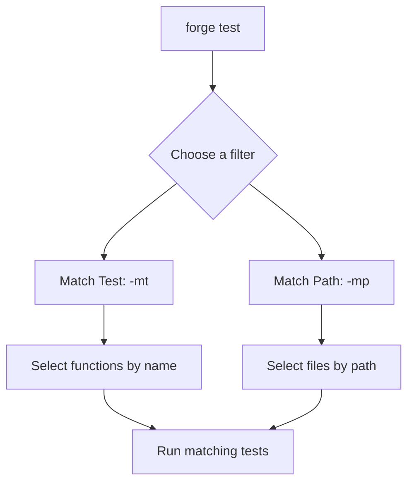
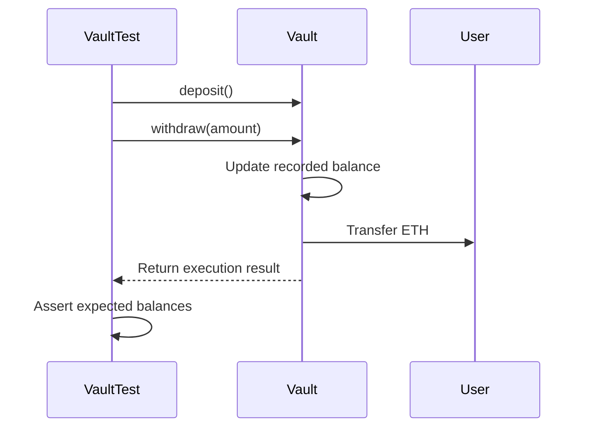
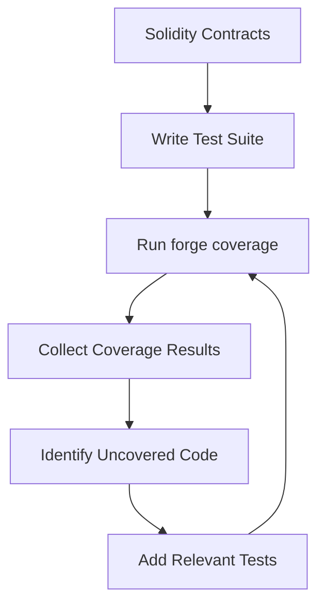
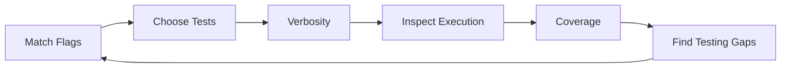

# Foundry Testing: Match Flags, Verbosity & Code Coverage

## Overview

Day 06 focuses on improving the way I run, inspect, and evaluate smart contract tests using Foundry.

Instead of adding new Solidity code, I explored three important testing concepts:

- Match Flags — Run specific tests or test files.
- Verbosity Flags — Control the amount of information displayed during test execution.
- Code Coverage — Measure which parts of the code are executed by the test suite.

These tools make testing workflows more targeted, debugging more informative, and test quality easier to evaluate.

## 1. Match Flags

Match flags allow us to filter the tests that Foundry executes instead of running the entire test suite every time.

This is particularly useful when a project contains many contracts and test functions.

### 1.1 Match Test — `-mt`

The `-mt` shorthand corresponds to `--match-test`.

It filters test functions by their names using a regular expression.

```bash
forge test --match-test "test_withdraw"
```

Short form:

```bash
forge test -mt "test_withdraw"
```

For example, if the test suite contains:

```solidity
function test_deposit() public {}
function test_withdraw() public {}
function test_withdraw_Revert_If_Insufficient_Balance() public {}
```

Matching `test_withdraw` selects test functions whose names match that expression.

The filter is based on names, not on the Solidity logic inside the functions.

### 1.2 Match Path — `-mp`

The `-mp` shorthand corresponds to `--match-path`.

It filters tests by the path of the test file.

```bash
forge test --match-path "test/Vault.t.sol"
```

Short form:

```bash
forge test -mp "test/Vault.t.sol"
```

A path pattern can also match multiple files:

```bash
forge test -mp "test/**/*.t.sol"
```

This is useful when you want to focus on a particular contract's tests or a specific test directory.

### Match Flags: Visual Overview



### Combining Match Flags

You can combine filters when you want to narrow the scope further.

```bash
forge test -mp "test/Vault.t.sol" -mt "test_withdraw"
```

This selects tests in the specified file whose function names match the supplied test pattern.

**Important:** A test filter determines what runs. It does not prove that the excluded tests pass.

## 2. Verbosity Flags

Verbosity controls how much diagnostic information Foundry prints while executing tests.

The basic command is:

```bash
forge test
```

You can increase the verbosity by adding more `v` characters.

```bash
forge test -v
forge test -vv
forge test -vvv
forge test -vvvv
forge test -vvvvv
```

Each level exposes additional information depending on the command and the type of output.

### Verbosity Levels

| Command | What to expect |
|---|---|
| `forge test` | Standard test results and summary |
| `forge test -v` | Increased logging verbosity |
| `forge test -vv` | Test logs and additional details |
| `forge test -vvv` | Execution traces for failing tests |
| `forge test -vvvv` | Execution traces for all tests and setup traces for failing tests |
| `forge test -vvvvv` | Execution and setup traces for all tests, including storage changes and backtraces |

The exact output depends on what the tests execute and log.

### Understanding Execution Traces

Execution traces help reveal the sequence of calls made during a test.

For example, a withdrawal test might conceptually follow this sequence:



The diagram represents the intended logical flow of a withdrawal test, not a literal trace captured from a specific command execution.

### When Should Each Level Be Used?

- Use the default output for a quick overview of the test suite.
- Use `-vv` when you need to inspect logs or understand assertion output.
- Use `-vvv` when a test fails and you need to investigate its execution path.
- Use `-vvvv` or `-vvvvv` when deeper tracing is needed to understand calls, setup behavior, or state changes.

More output can help with debugging, but it does not automatically make a test more thorough.

## 3. Code Coverage

Code coverage measures which parts of a program are exercised while the test suite runs.

Foundry provides the `forge coverage` command to analyze coverage for Solidity projects.

```bash
forge coverage
```

Unlike a normal test run, which primarily reports whether tests passed or failed, coverage helps identify code that the current test suite does not execute.

### Why Is Coverage Important?

Consider a contract with three functions:

```solidity
contract ExampleVault {
    function deposit() external payable {
        // Deposit logic
    }

    function withdraw(uint256 amount) external {
        // Withdrawal logic
    }

    function emergencyWithdraw() external {
        // Emergency withdrawal logic
    }
}
```

If the tests exercise `deposit()` and `withdraw()` but never call `emergencyWithdraw()`, part of the contract remains untested by execution.

Coverage can help identify that gap.

### Coverage Workflow



This creates an iterative process: write tests, measure coverage, identify gaps, and improve the test suite.

### Understanding Coverage Metrics

Coverage tools can report several kinds of coverage, depending on the report and tool configuration.

- **Function coverage:** Whether functions are exercised.
- **Statement coverage:** Whether executable statements are reached.
- **Line coverage:** Whether executable source lines are reached.
- **Branch coverage:** Whether alternative control-flow paths are exercised, where supported by the report.

For example, consider:

```solidity
function withdraw(uint256 amount) external {
    require(amount > 0, "Zero amount");
    require(balances[msg.sender] >= amount, "Insufficient balance");

    balances[msg.sender] -= amount;
}
```

A test that successfully withdraws funds may exercise the successful path through these checks. Additional tests are needed to exercise the rejection paths, such as a zero withdrawal amount or an insufficient balance.

This illustrates why simply calling a function does not necessarily exercise all its possible paths.

### Coverage Is Not the Same as Test Quality

High coverage is useful, but it does not guarantee that a contract is correct or secure.

A line can execute without its behavior being properly verified. A test might call a function but fail to assert that the resulting state is correct.

Good testing combines coverage with meaningful assertions, positive scenarios, negative scenarios, and security-focused reasoning.

## 4. Comparing the Three Concepts

| Feature | Main purpose | Key question |
|---|---|---|
| Match Flags | Filter the tests that run | Which tests should execute? |
| Verbosity Flags | Control diagnostic output | How much execution detail do I need? |
| Code Coverage | Measure executed code | Which parts of the code are exercised? |

### How They Fit Together



Together, these concepts support a more focused and informative testing workflow.

## 5. Practical Command Reference

```bash
# Run the full test suite
forge test

# Match a test function by name
forge test -mt "test_withdraw"

# Match a test file by path
forge test -mp "test/Vault.t.sol"

# Run a filtered test with more output
forge test -mt "test_withdraw" -vv

# Increase diagnostic detail
forge test -vvvv

# Generate a code coverage report
forge coverage
```

The examples use the short forms supported by Foundry. The corresponding long forms are `--match-test` and `--match-path`.

## Key Takeaways

- Match flags help focus test execution on relevant functions or files.
- Verbosity flags reveal additional logs and execution details when debugging.
- Code coverage helps identify parts of the code that tests do not exercise.
- Uncovered code can guide the next round of test development.
- Coverage percentages should be interpreted alongside assertions and test scenarios.
- A successful test run and high coverage are useful signals, but neither alone guarantees correctness or security.

## Summary

Day 06 strengthened my understanding of Foundry's testing workflow without requiring changes to the Solidity implementation.

I explored how to filter tests with match flags, inspect execution using verbosity levels, and evaluate test completeness using code coverage.

These concepts are important for building a more efficient testing workflow as smart contract projects grow in complexity.

## References

- [Foundry — Writing Tests](https://getfoundry.sh/forge/tests)
- [Foundry — Forge Reference](https://getfoundry.sh/reference)
- [Foundry — Code Coverage Guide](https://www.getfoundry.sh/guides/testing/code-coverage)
