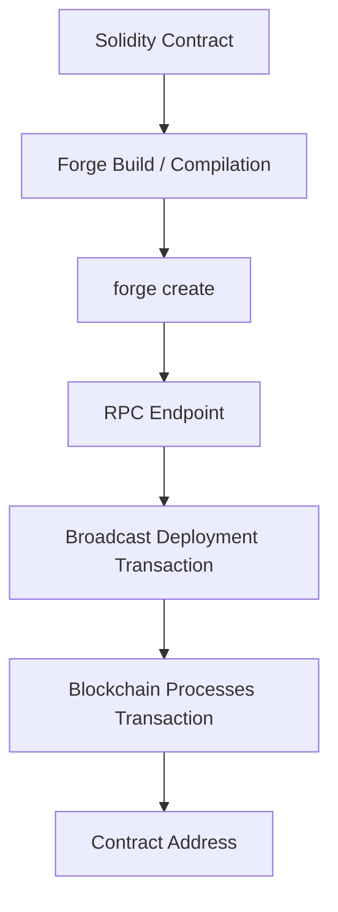
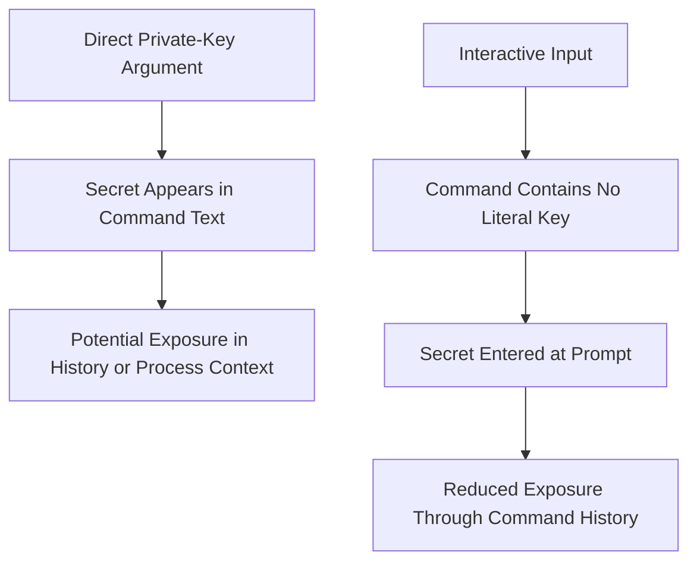
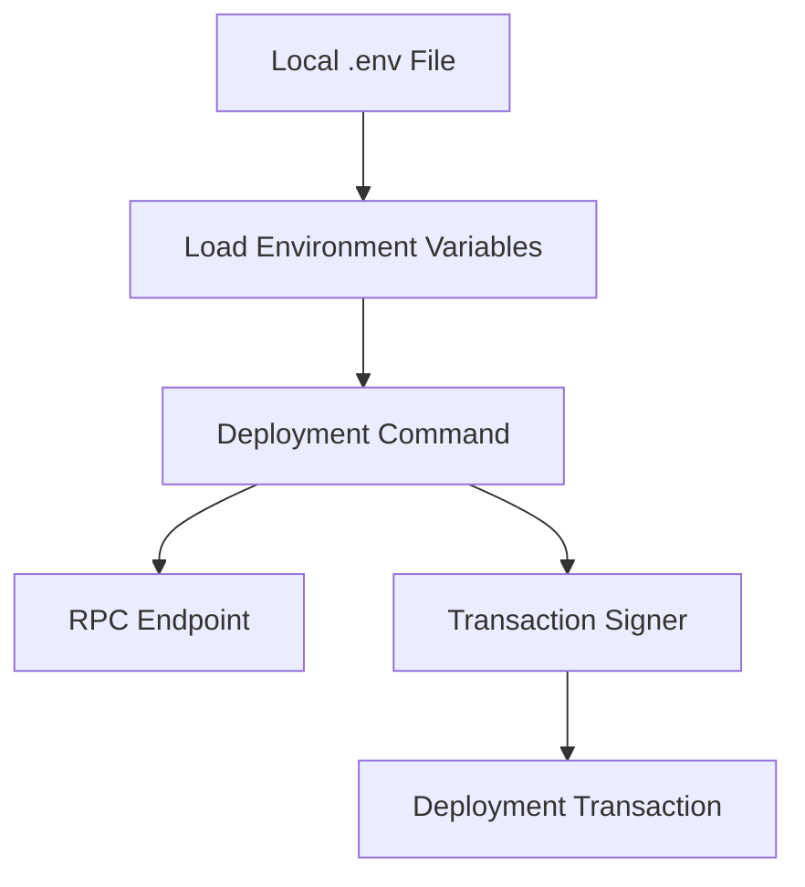
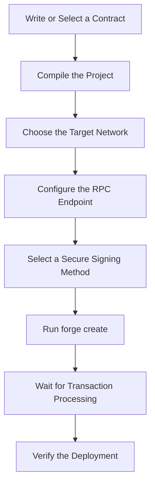

# Contract Deployment, Environment Variables & Cast Wallet

## Overview

Today's learning focused on understanding how smart contracts can be deployed using Foundry, how RPC endpoints connect development tools to an Ethereum network, and how to handle sensitive deployment information more carefully.

The goal was to explore several approaches to deployment, starting with simple commands and gradually moving toward safer and more structured workflows.

No Solidity contract code was changed during this session. This day documents the tools, commands, concepts, and security practices covered in the tutorials.

## Learning Objectives

By the end of this session, I explored:

- Deploying contracts with `forge create`.
- Connecting to a blockchain through an RPC URL.
- Using public RPC endpoints for initial learning and experimentation.
- Understanding the risks of entering private keys directly in terminal commands.
- Cleaning Bash terminal history.
- Using the `--interactive` option during deployment.
- Understanding environment variables and `.env` files.
- Exploring Foundry's `cast wallet` commands.
- Recognizing the difference between a basic learning workflow and a more secure deployment workflow.

---

## 1. Deploying a Contract with `forge create`

Foundry provides the `forge create` command to deploy a compiled Solidity contract to a blockchain network.

A deployment requires several pieces of information, including:

- The contract to deploy.
- An RPC endpoint for communicating with the target network.
- A way to authorize the deployment transaction, usually through a private key or another supported signer workflow.

### Basic Command Structure

```bash
forge create <contract-name> \
  --rpc-url <rpc-url> \
  --private-key <private-key>
```

For example, the tutorial demonstrated the following command structure:

```bash
forge create Vault \
  --rpc-url <rpc-url> \
  --private-key <private-key>
```

Here:

- `forge create` initiates the deployment workflow.
- `Vault` identifies the contract being deployed.
- `--rpc-url` specifies the blockchain endpoint.
- `--private-key` supplies the key used to authorize the deployment transaction.

The placeholders above must be replaced with valid values for the intended environment.

### What Happens During Deployment?



The deployment transaction is submitted to the selected network. If the transaction succeeds, the network creates the contract and provides a contract address.

A successful local compilation does not mean the contract has been deployed. Deployment requires a transaction to be processed by the target network.

### Important Considerations

- The selected RPC endpoint determines which network receives the transaction.
- Deployment generally requires the appropriate native currency to pay transaction fees.
- The account must be able to authorize the transaction.
- Always verify the target network and contract address before interacting with the deployed contract.

---

## 2. RPC URLs and Blockchain Node Providers

An RPC endpoint allows development tools to communicate with a blockchain node or a service that provides blockchain access.

Foundry uses the RPC URL to send requests to the selected network, including requests needed to submit transactions.

### Public RPC Endpoints

For initial learning and experimentation, public RPC endpoints can be convenient.

Chainlist is a resource for discovering network information and RPC endpoints:

https://chainlist.org/

When selecting an endpoint, verify the network and the endpoint's reliability. Public endpoints may have rate limits, availability issues, or other restrictions.

### Professional RPC Providers

Dedicated RPC providers offer managed access to blockchain networks. Examples include:

- Infura: https://www.infura.io/
- QuickNode: https://www.quicknode.com/

Depending on the service and plan, these providers may offer API credentials, usage monitoring, reliability features, and additional infrastructure capabilities.

A managed RPC provider is not automatically secure in every configuration. API credentials must still be handled carefully, and production systems require appropriate operational and security practices.

### Basic vs. Production-Oriented Workflows

| Learning workflow | More structured workflow |
|---|---|
| Public RPC endpoint | Managed RPC provider when appropriate |
| Manual command execution | Repeatable deployment scripts |
| Interactive input for local experimentation | Carefully configured signer and secret-management workflow |
| Manual verification | Automated checks and deployment verification |

The purpose of beginning with simpler workflows is to understand each component before introducing more advanced deployment practices.

---

## 3. Cleaning Terminal History

During the tutorial, we explored commands for clearing Bash terminal history after working with sensitive command-line input.

### Clear the Current Bash Session History

```bash
history -c
```

This clears the current Bash shell's in-memory history list.

### Remove the Saved Bash History File

```bash
rm ~/.bash_history
```

This removes the default saved Bash history file for the current user.

### Important Security Limitation

These commands do not guarantee that a private key has been removed from every possible location.

Depending on the shell, terminal, operating system, and configuration, command information may exist in other sessions, history files, logs, or other records.

Deleting a history file also does not automatically clear every running shell's in-memory history.

**The better practice is to avoid placing private keys directly in command arguments in the first place.**

If a real private key has been exposed, removing terminal history should not be considered sufficient protection. Treat the key as compromised and follow an appropriate key-rotation or account-migration procedure.

> The history commands demonstrated here are Bash-specific. Windows PowerShell uses different history mechanisms.

---

## 4. Interactive Deployment with `--interactive`

The next approach uses Foundry's interactive option to request sensitive input during execution rather than placing the private key directly in the command.

### Command Example

```bash
forge create Vault \
  --rpc-url <rpc-url> \
  --interactive
```

With this approach, Foundry prompts for the required private-key input in the terminal.

The command no longer contains the private key as a literal argument.

### Why Is This an Improvement?

Compare the two approaches:



Interactive input reduces one important exposure risk: placing the secret directly in the command text.

However, it does not replace a complete secret-management strategy. The key is still sensitive, and its handling depends on the tool and environment.

### Example Terminal Session

```text
$ forge create Vault --rpc-url <rpc-url> --interactive

Enter private key:
```

The screenshot used in the tutorial demonstrated this interactive prompt. It was an instructional example rather than evidence of a deployment performed on my own machine.

---

## 5. Environment Variables and `.env` Files

Environment variables provide a way to configure applications and command-line tools without repeatedly writing configuration values directly into commands.

For local development, a `.env` file can store values that are loaded into the environment when needed.

### Example `.env` File

```dotenv
RPC_URL=https://your-rpc-endpoint
PRIVATE_KEY=your_private_key
```

These values are placeholders. Never publish a real private key or secret RPC credential.

### Example Workflow in Bash

First, create a `.env` file in the appropriate project directory.

Then load its variables into the current shell:

```bash
set -a
source .env
set +a
```

The `set -a` option exports subsequently defined variables automatically. `source .env` executes the file in the current shell, and `set +a` disables automatic exporting afterward.

Only source a `.env` file that you trust. Shell-based `.env` files are executable shell input, not merely passive configuration data.

A deployment command can then reference the environment variables:

```bash
forge create Vault \
  --rpc-url "$RPC_URL" \
  --private-key "$PRIVATE_KEY"
```

This avoids writing the actual values directly into the command text. However, shell expansion and process argument handling may still expose secrets to other processes or system tools, depending on the environment.

For workflows where private keys must not enter command arguments, use an appropriate signer or wallet integration instead.

### Protect the `.env` File

Add the following entry to `.gitignore`:

```gitignore
.env
```

If the project uses additional secret files, ensure they are ignored as well.

Before pushing changes, inspect the staged files:

```bash
git status
git diff --cached
```

Never commit a real private key, seed phrase, or secret API credential.

### Configuration Flow



### Important Distinction

A `.env` file improves configuration management, but it is not an encrypted vault. Its contents are stored as readable text unless additional protection is applied.

For production deployments, consider dedicated secret-management systems and secure signing workflows appropriate to the environment.

---

## 6. Foundry's `cast wallet`

Foundry includes several command-line tools:

- **Forge:** Builds, tests, and deploys Solidity projects.
- **Cast:** Interacts with EVM-compatible blockchains and provides utilities for addresses, transactions, calls, and wallet-related operations.
- **Anvil:** Runs a local Ethereum development node.
- **Chisel:** Provides an interactive Solidity REPL.

The tutorial introduced `cast wallet` as part of Foundry's wallet-related functionality.

### What Is `cast wallet`?

`cast wallet` groups wallet-related commands that can help with tasks such as key generation, key inspection, signing, and other supported wallet operations.

Available commands and options depend on the installed Foundry version.

To inspect the commands available in the local installation:

```bash
cast wallet --help
```

For help with a particular subcommand:

```bash
cast wallet <subcommand> --help
```

### Why Does It Matter?

Wallet functionality is important because smart contract deployment and other state-changing blockchain transactions require authorization.

Understanding wallet tools helps developers distinguish between:

- An account address used to identify an account.
- A private key used to authorize operations.
- A signed transaction submitted to a network.
- The RPC endpoint through which the transaction is sent.

Never share a private key or seed phrase in a repository, screenshot, public terminal recording, or chat.

For real funds, prefer established wallet or signer integrations and follow the relevant security guidance instead of casually handling raw private keys.

---

## 7. Putting the Concepts Together

The topics covered today form a basic deployment workflow.



Each stage has a different responsibility:

1. **Contract:** Defines the code to deploy.
2. **Compilation:** Produces the deployment artifacts.
3. **Network selection:** Determines where the contract will be deployed.
4. **RPC configuration:** Establishes communication with the network.
5. **Signing:** Authorizes the deployment transaction.
6. **Deployment:** Submits the transaction.
7. **Verification:** Confirms the transaction result and contract address.

A deployment command is only one part of the complete workflow. Reliable deployment also requires careful network selection, secure key handling, transaction verification, and appropriate testing.

---

## Key Takeaways

- `forge create` is used to deploy compiled contracts to an EVM-compatible network.
- RPC endpoints provide access to blockchain nodes or managed RPC services.
- Public endpoints are useful for learning, but endpoint selection should account for reliability and security.
- Interactive input reduces the need to place a private key directly in a command.
- Bash history cleanup is not a complete secret-removal mechanism.
- Environment variables improve configuration management, but `.env` files remain sensitive plaintext files.
- `.env` files and other secrets must never be committed to GitHub.
- `cast wallet` provides wallet-related command-line functionality within Foundry.
- A successful deployment should be verified on the intended network.

## Session Status

This session focused on learning command-line workflows and understanding deployment and security concepts.

No Solidity source code was changed, and this documentation does not claim that a deployment was performed on my machine.

The next step is to continue learning Foundry's deployment and wallet workflows, gradually moving from basic experimentation toward more secure and repeatable development practices.

## References

- Foundry Documentation: https://getfoundry.sh/
- Forge Commands: https://getfoundry.sh/forge/reference/forge-create/
- Cast Documentation: https://getfoundry.sh/cast/overview/
- Chainlist: https://chainlist.org/
- Infura: https://www.infura.io/
- QuickNode: https://www.quicknode.com/
