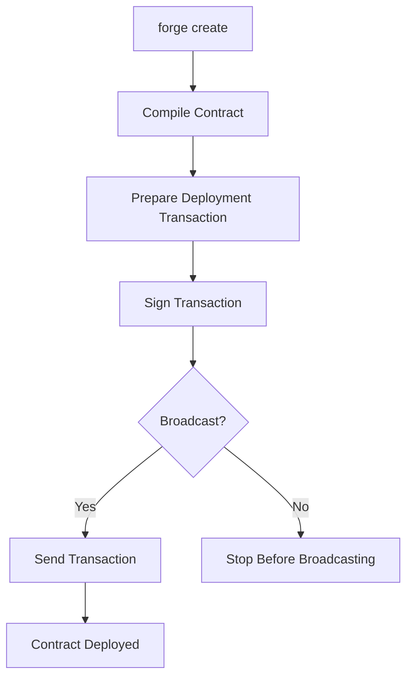
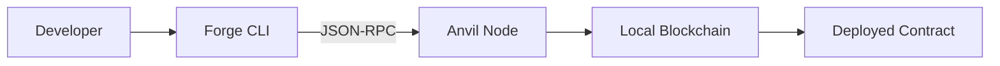
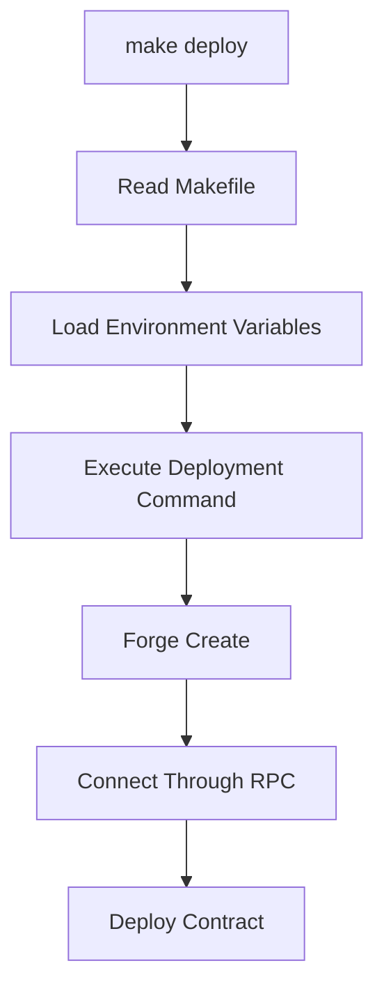
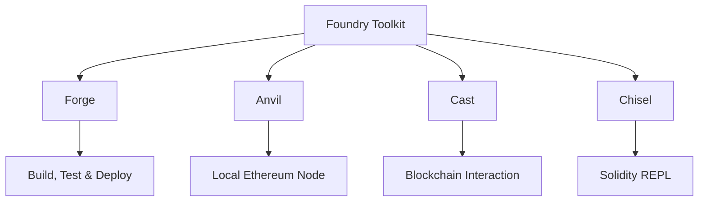

# Foundry: Deployment, Local Blockchain & Build Automation

This day focuses on understanding how to deploy smart contracts using Foundry, work with a local Ethereum development environment, and simplify repetitive development tasks through Makefiles.

## Table of Contents

- [1. Deploying Contracts with Forge Create](#1-deploying-contracts-with-forge-create)
- [2. Anvil: Local Ethereum Node](#2-anvil-local-ethereum-node)
- [3. Deploying to Anvil](#3-deploying-to-anvil)
- [4. Makefiles and Build Automation](#4-makefiles-and-build-automation)
- [5. Understanding Compiler Warnings](#5-understanding-compiler-warnings)
- [6. Foundry MCQ #3](#6-foundry-mcq-3)
- [7. Key Takeaways](#7-key-takeaways)

---

## 1. Deploying Contracts with Forge Create

Foundry provides `forge create` to deploy a smart contract directly from the command line.

Unlike deployment scripts, `forge create` offers a straightforward way to deploy a contract by specifying its name, deployment account, and target network.

### Basic Syntax

```bash
forge create <ContractName> \
  --rpc-url <RPC_URL> \
  --private-key <PRIVATE_KEY> \
  --broadcast
```

### Important Flags

| Flag | Description |
|---|---|
| `--rpc-url` | Specifies the RPC endpoint of the target network. |
| `--private-key` | Provides the private key used to sign the deployment transaction. |
| `--broadcast` | Sends the signed transaction to the network. |
| `--verify` | Requests contract verification when supported and configured. |

Without `--broadcast`, Forge can prepare and simulate a deployment without sending the transaction to the network.

### Deployment Workflow



---

## 2. Anvil: Local Ethereum Node

**Anvil** is Foundry's local Ethereum development node.

It provides a simulated blockchain environment that allows developers to deploy and interact with smart contracts without using a public network or spending real cryptocurrency.

### Starting Anvil

```bash
anvil
```

When started, Anvil creates a local blockchain and provides pre-funded development accounts with their corresponding private keys.

By default, its JSON-RPC endpoint is:

```text
http://127.0.0.1:8545
```

### Why Use Anvil?

- **Local Development:** Develop and test contracts without deploying to a public network.
- **Pre-funded Accounts:** Use ready-made accounts with test ETH.
- **Fast Transactions:** Execute transactions locally without waiting for public network confirmations.
- **Controlled Environment:** Reset and reproduce blockchain states during development.
- **No Real Funds Required:** Experiment without risking real assets.

Anvil is especially useful during the development and testing stages of smart contract projects.

---

## 3. Deploying to Anvil

After starting Anvil, we can deploy contracts to its local blockchain using `forge create`.

### Step 1 — Start the Local Node

```bash
anvil
```

Keep Anvil running in a separate terminal.

### Step 2 — Deploy the Contract

```bash
forge create Vault \
  --rpc-url http://127.0.0.1:8545 \
  --private-key <ANVIL_PRIVATE_KEY> \
  --broadcast
```

Use one of the private keys generated by Anvil for local development only.

### Step 3 — Understand the Result

After a successful deployment, Forge returns useful information, including:

- The deployed contract address.
- The transaction hash.
- The account used for deployment.

The contract now exists on the local Anvil blockchain and can be interacted with through its address.

### Deployment Architecture



---

## 4. Makefiles and Build Automation

A **Makefile** is a configuration file used by the `make` build automation tool.

It defines named tasks, known as targets, and the commands that should execute when those targets are requested.

Instead of repeatedly typing long commands, developers can organize common operations into reusable tasks.

### Why Are Makefiles Useful?

As projects grow, developers often repeat commands for:

- Compiling contracts.
- Running tests.
- Checking formatting.
- Deploying contracts.
- Running local development tools.

A Makefile provides a centralized and consistent way to execute these operations.

### Basic Makefile Structure

```makefile
target:
	command
```

A target represents a task, while the command below it defines what should happen when that task is executed.

**Important:** Commands inside Makefile recipes must begin with a TAB character, not spaces.

### Example

```makefile
build:
	forge build

test:
	forge test

clean:
	forge clean
```

Execute a target using:

```bash
make build
make test
make clean
```

### Using Environment Variables

Makefiles can also use variables to avoid hardcoding configuration values.

For example:

```makefile
-include ../.env

deploy:
	forge create Vault \
		--private-key ${ANVIL_PRIVATE_KEY} \
		--rpc-url ${ANVIL_RPC_URL} \
		--broadcast
```

This example loads environment variables from a `.env` file located in the parent directory and uses them during deployment.

The deployment can then be executed with:

```bash
make deploy
```

### Makefile Deployment Workflow



### Makefile vs. Shell Scripts

Both Makefiles and shell scripts can automate commands, but they serve somewhat different purposes.

| Makefile | Shell Script |
|---|---|
| Organizes tasks into targets. | Executes a sequence of shell commands. |
| Supports dependencies between targets. | Requires explicit control flow for task ordering. |
| Commonly used for build workflows. | Useful for general automation and system tasks. |
| Runs targets through `make`. | Runs through a shell interpreter. |

### Security Considerations

Environment variables help separate configuration from commands, but a `.env` file is not encrypted.

A few important practices:

- Never commit private keys or secrets.
- Add `.env` to `.gitignore`.
- Use dedicated local development accounts when working with Anvil.
- Avoid using real wallet private keys in command-line experiments.
- Use dedicated secret-management solutions for production environments.

---

## 5. Understanding Compiler Warnings

A compiler warning indicates that the compiler has detected something potentially problematic or worth reviewing.

Unlike compilation errors, warnings do not necessarily prevent the contract from compiling.

However, ignoring warnings can hide problems that may affect code quality, maintainability, or security.

### Warnings vs. Errors

| Warnings | Errors |
|---|---|
| Indicate potential issues. | Indicate problems that prevent successful compilation. |
| Compilation may still succeed. | Compilation fails until the issue is resolved. |
| Should be reviewed and understood. | Must be fixed before successful compilation. |

### Common Solidity Warning Categories

- **Unused Variables:** Variables declared but never used.
- **Unused Parameters:** Function parameters that are not used.
- **Mutability Suggestions:** Functions that could use `pure` or `view`.
- **Missing SPDX License Identifier:** Source files without an SPDX license declaration.
- **Compiler Version Considerations:** Version-related notices that may require reviewing compiler configuration.

### Example

```solidity
// SPDX-License-Identifier: MIT
pragma solidity ^0.8.20;

contract WarningExample {
    uint256 public value;

    function calculate(uint256 unusedParameter)
        public
        pure
        returns (uint256)
    {
        uint256 unusedVariable = 10;
        return 5;
    }
}
```

The compiler can report that `unusedParameter` and `unusedVariable` are unused.

The important lesson is to understand why a warning appears rather than simply ignoring it.

---

## 6. Foundry MCQ #3

This section is dedicated to the third Foundry multiple-choice exercise.

The purpose of these exercises is to reinforce Foundry concepts, command-line workflows, and practical development knowledge.

> Add the question, selected answer, and explanation here after reviewing the MCQ.

---

## 7. Key Takeaways

By completing this learning session, the main concepts covered include:

- Deploying smart contracts directly using `forge create`.
- Understanding the role of RPC endpoints during deployment.
- Using Anvil as a local Ethereum development node.
- Deploying contracts to a local blockchain.
- Understanding Makefiles and their role in build automation.
- Organizing repetitive Foundry commands into reusable targets.
- Loading configuration through environment variables.
- Recognizing the importance of reviewing compiler warnings.
- Keeping private keys and sensitive configuration out of version control.

### Foundry Tooling Overview



---

**Learning Focus:** Moving beyond writing and testing smart contracts toward understanding deployment workflows, local blockchain environments, and automation tools that make development more efficient.