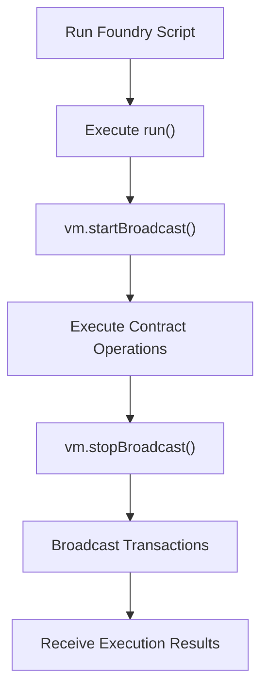

# Interacting with Smart Contracts Using Foundry

## Table of Contents

- [Introduction](#introduction)
- [1. Interacting with Contracts Through the CLI](#1-interacting-with-contracts-through-the-cli)
  - [1.1 Sending Ether to Payable Functions](#11-sending-ether-to-payable-functions)
  - [1.2 Calling State-Changing Functions with Parameters](#12-calling-state-changing-functions-with-parameters)
  - [1.3 Reading Contract Data with cast call](#13-reading-contract-data-with-cast-call)
- [2. Working with Number Bases and Unit Conversions](#2-working-with-number-bases-and-unit-conversions)
- [3. Interacting with Contracts Through Solidity Scripts](#3-interacting-with-contracts-through-solidity-scripts)
  - [3.1 What Are Foundry Scripts?](#31-what-are-foundry-scripts)
  - [3.2 Understanding the Script Workflow](#32-understanding-the-script-workflow)
  - [3.3 Broadcasting Transactions](#33-broadcasting-transactions)
  - [3.4 Running a Script](#34-running-a-script)
- [4. Chisel: The Solidity REPL](#4-chisel-the-solidity-repl)
- [5. CLI vs. Solidity Scripts](#5-cli-vs-solidity-scripts)
- [6. Security Considerations](#6-security-considerations)
- [7. Key Takeaways](#7-key-takeaways)
- [8. References](#8-references)

---

## Introduction

Interacting with smart contracts is a fundamental part of Ethereum development.

After writing and deploying a smart contract, developers need ways to read its data, execute its functions, transfer Ether, test different interactions, and automate blockchain operations.

Foundry provides several tools for these tasks. One of its most useful components is Cast, a command-line tool for interacting with Ethereum networks. Foundry also supports Solidity-based scripts for automating complex workflows, while Chisel provides an interactive environment for experimenting with Solidity expressions.

This guide explores these tools and explains how to use them effectively.

## 1. Interacting with Contracts Through the CLI

Foundry's Cast tool provides commands for interacting directly with deployed smart contracts.

The two commands most commonly used for contract interaction are:

- `cast send`: Sends a transaction that can change blockchain state.
- `cast call`: Executes a read-only contract call without creating an on-chain transaction.

### 1.1 Sending Ether to Payable Functions

In Solidity, a function must be marked as `payable` to accept Ether.

Example:

```solidity
// SPDX-License-Identifier: MIT
pragma solidity ^0.8.20;

contract Deposit {
    event Deposited(address indexed sender, uint256 amount);

    function deposit() external payable {
        emit Deposited(msg.sender, msg.value);
    }
}
```

The `payable` keyword allows the function to receive Ether.

Two important global variables are available inside the function:

- `msg.sender`: The address that called the function.
- `msg.value`: The amount of Ether sent with the transaction, denominated in wei.

To call this function and send Ether using Cast:

```bash
cast send <CONTRACT_ADDRESS> \
    "deposit()" \
    --value 1ether \
    --private-key <PRIVATE_KEY> \
    --rpc-url <RPC_URL>
```

**Understanding the command:**

| Argument | Description |
|---|---|
| `cast send` | Creates and sends a transaction. |
| `CONTRACT_ADDRESS` | The target contract address. |
| `"deposit()"` | The function signature. |
| `--value 1ether` | The amount of Ether sent with the transaction. |
| `--private-key` | The key used to sign the transaction. |
| `--rpc-url` | The RPC endpoint of the target network. |

The transaction is signed and submitted to the network. Once included in a block, the contract executes the function and can update its state.

**Important:** A function that is not marked `payable` cannot receive Ether through `msg.value`.

### 1.2 Calling State-Changing Functions with Parameters

Smart contracts often contain functions that accept parameters and modify their internal state.

Example:

```solidity
// SPDX-License-Identifier: MIT
pragma solidity ^0.8.20;

contract Storage {
    uint256 public storedValue;

    function setValue(uint256 newValue) external {
        storedValue = newValue;
    }
}
```

The `setValue` function changes the contract's state by updating `storedValue`.

To call it using Cast:

```bash
cast send <CONTRACT_ADDRESS> \
    "setValue(uint256)" 42 \
    --private-key <PRIVATE_KEY> \
    --rpc-url <RPC_URL>
```

Here:

- `setValue(uint256)` represents the function signature.
- `42` is the argument passed to the function.
- `cast send` creates a transaction that executes the function.

The function's execution modifies the contract's storage.

A transaction that changes blockchain state requires a transaction signature and gas.

**Function Signatures and Parameters**

A function signature identifies a function by its name and parameter types.

For example:

```solidity
function transfer(address recipient, uint256 amount) external;
```

Its signature is:

```text
transfer(address,uint256)
```

The corresponding Cast command can pass arguments after the signature:

```bash
cast send <CONTRACT_ADDRESS> \
    "transfer(address,uint256)" \
    <RECIPIENT_ADDRESS> 100 \
    --private-key <PRIVATE_KEY> \
    --rpc-url <RPC_URL>
```

The argument order and types must match the function signature.

### 1.3 Reading Contract Data with cast call

Not every interaction with a smart contract requires a transaction.

The `cast call` command allows developers to execute read-only contract calls without submitting an on-chain transaction.

Consider the following contract:

```solidity
// SPDX-License-Identifier: MIT
pragma solidity ^0.8.20;

contract Counter {
    uint256 public count;

    function getCount() external view returns (uint256) {
        return count;
    }
}
```

To read the current value:

```bash
cast call <CONTRACT_ADDRESS> \
    "getCount()(uint256)" \
    --rpc-url <RPC_URL>
```

The function signature includes the return type:

```text
getCount()(uint256)
```

The first parentheses contain the input parameter types, while the second contain the expected output types.

For a function with parameters:

```solidity
function balanceOf(address account) external view returns (uint256);
```

Use:

```bash
cast call <CONTRACT_ADDRESS> \
    "balanceOf(address)(uint256)" \
    <ACCOUNT_ADDRESS> \
    --rpc-url <RPC_URL>
```

**cast call vs. cast send**

| Feature | `cast call` | `cast send` |
|---|---|---|
| Purpose | Read contract data | Execute a transaction |
| On-chain transaction | No | Yes |
| Changes persistent state | No | Can |
| Requires transaction signature | No | Yes |
| Gas paid by caller | No on-chain gas payment | Yes |
| Typical use | Read balances and values | Transfer tokens and update state |

A useful distinction:

`cast call` performs an `eth_call` against a node. It does not create a transaction or persist state changes.

Although it is commonly used with `view` and `pure` functions, it can simulate other function calls too. Any simulated state changes are not persisted.

## 2. Working with Number Bases and Unit Conversions

Blockchain development frequently involves working with different numerical representations.

Ethereum uses wei as its smallest unit of Ether.

The main Ether denominations are:

| Unit | Wei Equivalent |
|---|---:|
| 1 Ether | 10^18 wei |
| 1 Gwei | 10^9 wei |
| 1 Wei | 1 wei |

For example:

```text
1 ETH = 1,000,000,000,000,000,000 Wei
1 Gwei = 1,000,000,000 Wei
```

Working with these large numbers manually can be inconvenient. Cast provides conversion commands to make this easier.

### 2.1 Converting Ether to Wei

Use `cast to-wei`:

```bash
cast to-wei 1 ether
```

Expected output:

```text
1000000000000000000
```

Another example:

```bash
cast to-wei 2.5 ether
```

### 2.2 Converting Wei to Ether

Use `cast from-wei`:

```bash
cast from-wei 1000000000000000000 ether
```

Expected output:

```text
1.0
```

You can also specify other denominations:

```bash
cast from-wei 1000000000 gwei
```

### 2.3 Converting Between Number Bases

Numbers can be represented using different bases.

| Number System | Base | Characters |
|---|---:|---|
| Binary | 2 | 0–1 |
| Decimal | 10 | 0–9 |
| Hexadecimal | 16 | 0–9, A–F |

Cast supports conversion between these representations.

**Decimal to Hexadecimal**

```bash
cast to-hex 255
```

Expected output:

```text
0xff
```

**Hexadecimal to Decimal**

```bash
cast to-dec 0xff
```

Expected output:

```text
255
```

**Convert to a Specific Base**

```bash
cast to-base 255 16
```

Expected output:

```text
ff
```

The exact output formatting can vary depending on the selected command and representation.

These conversions are useful when working with transaction data, hexadecimal addresses, calldata, and low-level Ethereum values.

## 3. Interacting with Contracts Through Solidity Scripts

Cast is convenient for individual commands, but complex interactions often involve multiple steps.

Foundry Scripts provide a way to write these operations in Solidity and execute them as an organized workflow.

### 3.1 What Are Foundry Scripts?

A Foundry Script is a Solidity contract designed to automate blockchain interactions.

Instead of manually running multiple CLI commands, developers can write a script that:

1. Deploys smart contracts.
2. Calls contract functions.
3. Sends Ether.
4. Reads contract data.
5. Coordinates multiple operations.

Scripts are commonly stored in the project's `script/` directory.

Example project structure:

```text
my-project/
├── src/
│   └── MyContract.sol
├── script/
│   └── Deploy.s.sol
├── test/
│   └── MyContract.t.sol
├── foundry.toml
└── README.md
```

### 3.2 Understanding the Script Workflow

Foundry scripts commonly import the `Script` contract from `forge-std`.

Example:

```solidity
// SPDX-License-Identifier: MIT
pragma solidity ^0.8.20;

import {Script} from "forge-std/Script.sol";

contract DeployScript is Script {
    function run() external {
        // Script logic
    }
}
```

**Important components:**

- `Script`: Provides the Foundry scripting interface and cheatcodes.
- `run()`: The main entry point executed by Foundry.
- `vm`: The cheatcode interface used to control script execution and broadcasting.

The `run()` function is where the script's operations are defined.

### 3.3 Broadcasting Transactions

One of the most important features of Foundry Scripts is transaction broadcasting.

Consider:

```solidity
function run() external {
    vm.startBroadcast();

    // Deployment and contract interactions

    vm.stopBroadcast();
}
```

**vm.startBroadcast()**

Starts broadcasting subsequent eligible contract interactions as transactions using the selected sender.

Operations executed within the broadcast section can include:

- Contract deployments.
- Function calls.
- Ether transfers.

**vm.stopBroadcast()**

Stops the broadcast section.

This gives developers control over which operations are intended to become transactions.

Conceptually, the workflow looks like this:



A script can perform several operations in sequence, making it useful for deployment workflows and multi-step interactions.

### 3.4 Running a Script

Foundry provides the `forge script` command.

A typical command is:

```bash
forge script script/Deploy.s.sol:DeployScript \
    --rpc-url <RPC_URL> \
    --broadcast
```

**Command breakdown:**

| Component | Description |
|---|---|
| `forge script` | Executes a Solidity script. |
| `script/Deploy.s.sol` | Path to the script file. |
| `:DeployScript` | Script contract name. |
| `--rpc-url` | Target network's RPC endpoint. |
| `--broadcast` | Broadcasts the generated transactions. |

Without `--broadcast`, Foundry can execute the script in simulation mode and display the planned transactions without submitting them to the network.

When `--broadcast` is supplied, the transactions are sent to the selected network.

**Choosing the Transaction Sender**

A script needs a sender when broadcasting transactions.

For example, a private key can be supplied using:

```bash
--private-key <PRIVATE_KEY>
```

Alternatively, Foundry supports using configured accounts and other signing methods.

Never hardcode private keys in Solidity scripts or commit sensitive credentials to version control.

## 4. Chisel: The Solidity REPL

Chisel is Foundry's interactive Solidity Read-Eval-Print Loop (REPL).

It allows developers to experiment with Solidity expressions and inspect their results without creating a complete Solidity project or writing a separate contract for every experiment.

Start Chisel using:

```bash
chisel
```

Inside the interactive environment, you can enter Solidity expressions and statements.

For example:

```solidity
uint256 number = 10;
```

Then:

```solidity
number * 2
```

The REPL evaluates the expression and displays its result.

### Common Uses of Chisel

**1. Testing Solidity Expressions**

Quickly evaluate arithmetic operations and expressions.

```solidity
uint256 a = 10;
uint256 b = 20;

a + b
```

**2. Exploring Data Types**

Experiment with Solidity types and conversions.

```solidity
uint256 value = 100;
uint8 smallValue = uint8(value);
```

**3. Testing Conditions**

Evaluate Boolean expressions and comparisons.

```solidity
uint256 balance = 100;

balance > 50
```

**4. Understanding Solidity Behavior**

Experiment with language features and verify how expressions behave before implementing them in a full contract.

### Why Use Chisel?

Without an interactive environment, testing a small Solidity expression may require creating a contract, compiling it, and running a test.

Chisel makes these experiments faster and more convenient.

However, Chisel is an experimentation tool. It does not replace proper contract tests, security reviews, or deployment scripts.

## 5. CLI vs. Solidity Scripts

Foundry offers multiple ways to interact with smart contracts. Choosing the right approach depends on the complexity and purpose of the task.

| Aspect | Cast CLI | Solidity Scripts |
|---|---|---|
| Interface | Terminal commands | Solidity code |
| Best suited for | Individual interactions | Multi-step workflows |
| Reusability | Commands can be saved and reused | Logic can be organized into scripts |
| Complexity | Simple and direct | Better for complex sequences |
| Typical use | Reading data and sending transactions | Deployments and automated interactions |

**When to use Cast:**

- Reading contract state.
- Sending a single transaction.
- Calling a function with parameters.
- Converting Ether denominations.
- Inspecting blockchain data.

**When to use Solidity Scripts:**

- Deploying multiple contracts.
- Executing several transactions in sequence.
- Automating deployment procedures.
- Repeating complex interactions across environments.

Both approaches are complementary and are commonly used together in Foundry development.

## 6. Security Considerations

Interacting with blockchain networks requires careful handling of private keys, transaction parameters, and network configuration.

Important practices include:

- Never expose private keys in public repositories.
- Never commit `.env` files containing sensitive credentials.
- Include `.env` in `.gitignore`.
- Use dedicated development accounts for local experiments.
- Verify the RPC URL and target network before broadcasting.
- Review transaction parameters before signing.
- Use local Anvil accounts for development and testing.
- Be careful when using `--broadcast` on public networks.

Remember that environment variables help separate configuration from source code, but they are not encrypted secrets.

## 7. Key Takeaways

Throughout this guide, we explored several essential Foundry capabilities:

- `cast send` allows developers to execute state-changing transactions.
- Payable functions can receive Ether through `msg.value`.
- Function parameters can be supplied directly through Cast.
- `cast call` provides read-only contract interaction without submitting an on-chain transaction.
- Cast supports Ether denomination and number-base conversions.
- Foundry Scripts allow developers to automate complex blockchain workflows using Solidity.
- `vm.startBroadcast()` and `vm.stopBroadcast()` define the broadcasting section of a script.
- Chisel provides an interactive environment for experimenting with Solidity.

Understanding these tools helps developers move beyond writing smart contracts and become more comfortable interacting with, automating, and testing blockchain applications.

## 8. References

Official documentation and learning resources:

1. [Foundry Book](https://book.getfoundry.sh/)
2. [Foundry Cast Documentation](https://getfoundry.sh/cast/overview)
3. [Cast Commands Reference](https://getfoundry.sh/cast/reference/cast)
4. [Foundry Scripting Documentation](https://getfoundry.sh/guides/scripting-with-solidity)
5. [Forge Script Reference](https://getfoundry.sh/forge/reference/script)
6. [Foundry Chisel Documentation](https://getfoundry.sh/chisel/overview)
7. [Solidity Documentation](https://docs.soliditylang.org/)

---

*This guide is part of an ongoing Blockchain and Web3 learning journey, documenting Foundry tools, Solidity development practices, and practical blockchain concepts.*